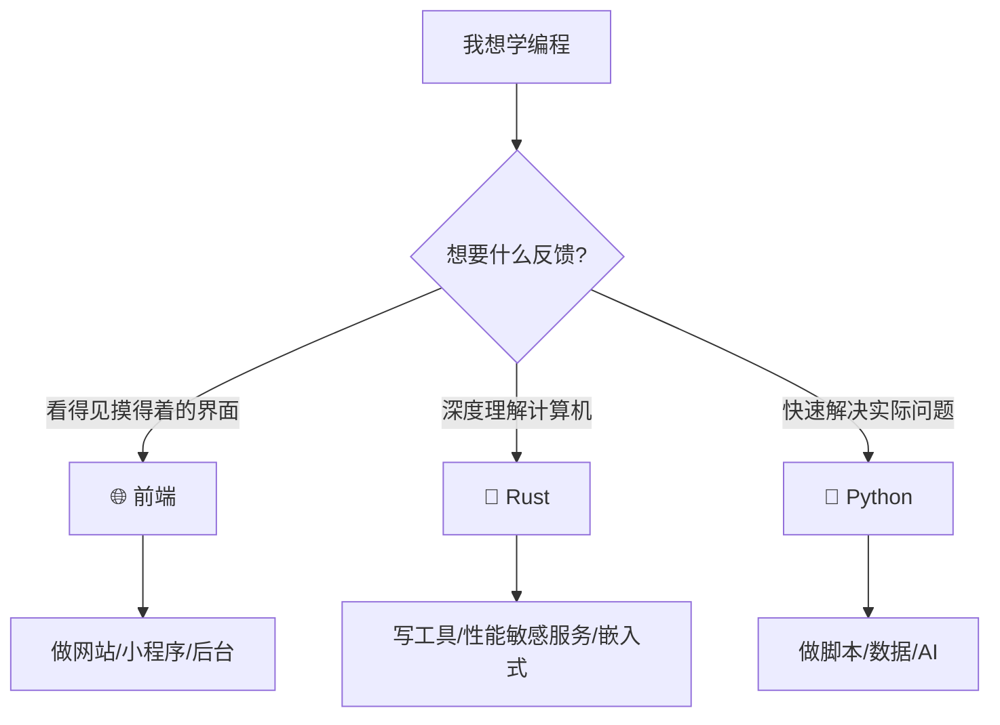

# 🎯 学习三大目标

本站聚焦三条**互不重叠但相互补完**的学习主线。选一条先深入，另外两条按需查阅即可，不建议同时开三条。

---

## 阶段 1：🌐 前端

**为什么先学**：反馈最快，一小时就能写出一个能跑的页面；对建立编程直觉最友好。

**已上线（React 主线）**：

1. React 是什么
2. 环境搭建
3. 组件与 Props
4. 状态 State
5. 事件处理
6. 渲染技巧
7. 实战项目 TodoList
8. 后续学习方向

**学习方向（后续会覆盖）**：JavaScript 基础 · TypeScript · HTML/CSS · 工程化（Vite / ESLint / Git）

**推荐入口**：
- 零基础 → 先看 [React 介绍](../react/1.md) 建立整体感
- 有 JS 基础 → 直接跳到「阶段 3：组件与 Props」

---

## 阶段 2：🦀 Rust

**为什么学**：一门能让你**理解内存/并发/抽象**的语言。学完 Rust 后回看 C/Go/JS，很多模糊的概念突然清晰。

**已上线（基础部分）**：

1. Rust 介绍
2. 环境搭建（rustup / cargo / VS Code）
3. 变量与类型
4. 所有权 Ownership ⭐（Rust 与其他语言的根本差异）

**学习方向（后续会覆盖）**：借用与生命周期 · struct/enum/trait · 错误处理 · 并发与异步 · 实战项目

**推荐入口**：[Rust 介绍](../rust/1.md)

---

## 阶段 3：🐍 Python

**为什么学**：**广度冠军**。任何"我知道要做一件事但不知道选什么语言"的场景，Python 几乎都能兜底——爬虫、自动化、数据处理、AI。

**已上线（基础部分）**：

1. Python 介绍
2. 环境搭建（pyenv / uv / VS Code）
3. 变量与控制流
4. 数据结构（list / tuple / dict / set / 推导式）

**学习方向（后续会覆盖）**：面向对象 · 函数与装饰器 · 标准库精选 · requests / pandas / fastapi 常用库 · 实战项目

**推荐入口**：[Python 介绍](../python/1.md)

---

## 🧭 三条主线的选择建议

---

## 📅 推荐节奏

- **每周投入 3–5 小时**：约 3 个月走完一条主线入门阶段
- **一主线一实践**：每周留 1 小时写小 demo，比追教程进度更重要
- **交叉学习**：前端 + Python 组合适合做全栈小项目；Rust + Python 组合适合做性能敏感的科学计算工具

---

## ✅ 下一步

选一条主线，从它的「阶段 1：介绍」开始。或者先去[文档首页](../intro.md)看写作规范，准备贡献内容。
